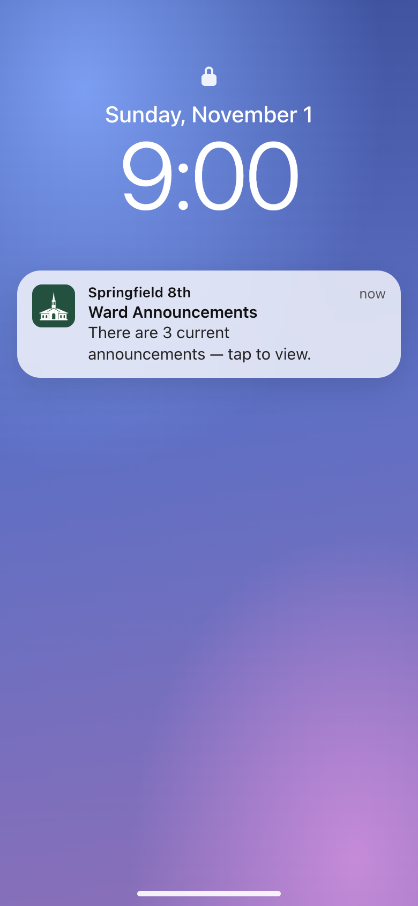
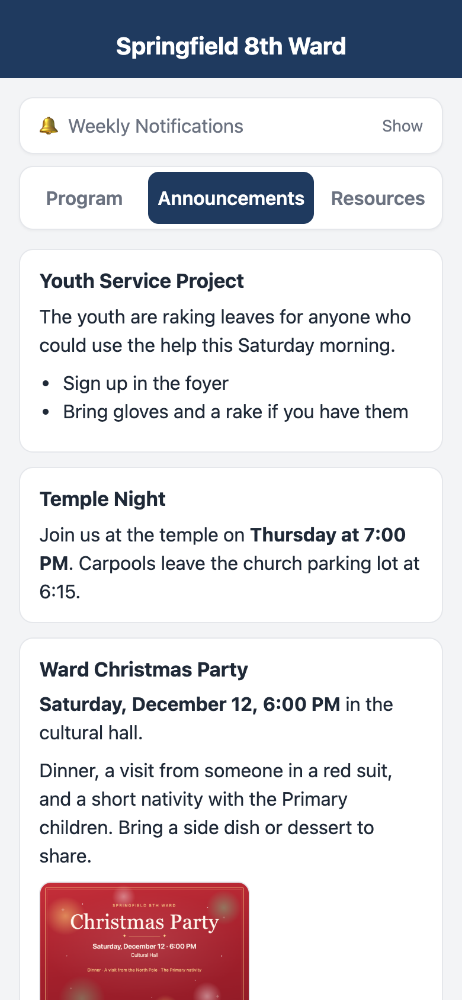
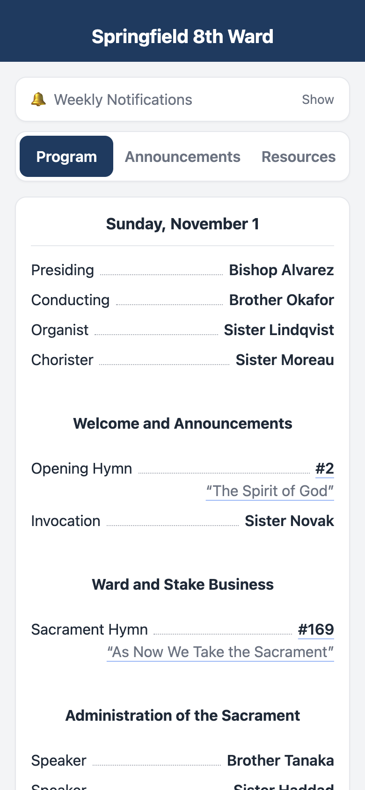
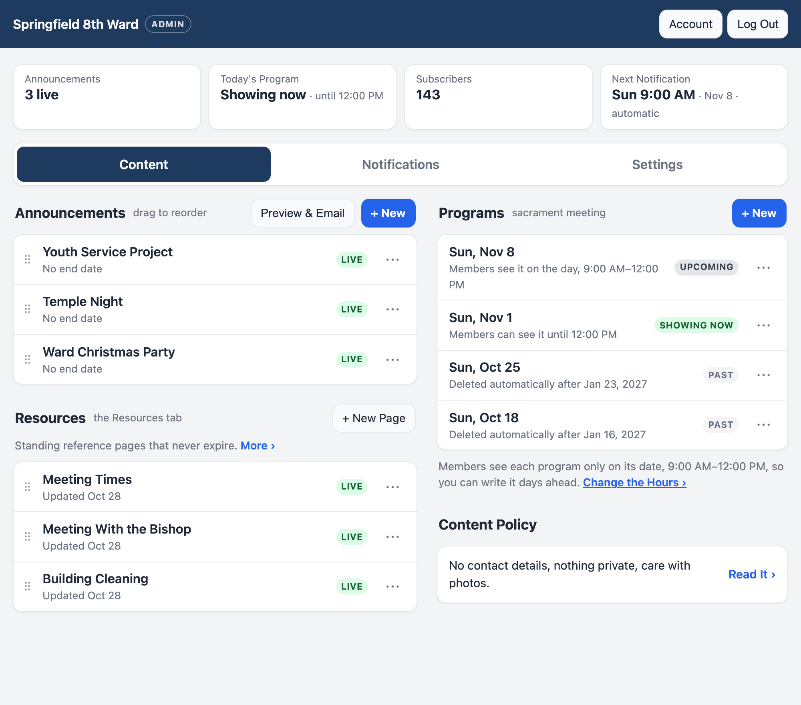

# Ward Announcements

[](https://github.com/luminationlabs/ward-announcements/actions/workflows/test.yml)

This is a small app for wards in The Church of Jesus Christ of Latter-day Saints. Members can open it on their phone to read the week's announcements and the sacrament meeting program, and they can turn on a notification that arrives on Sunday morning. There's a simple dashboard for keeping the announcements up to date.

This is not an official Church service, and that is stated on member-facing pages.

## Why

In April 2019 general conference, Elder Jeffrey R. Holland called sacrament meeting "the most sacred hour of our week" and said, "We congratulate those bishoprics who are eliminating announcements that detract from the spirit of our worship" (["Behold the Lamb of God"](https://www.churchofjesuschrist.org/study/general-conference/2019/04/28holland?lang=eng)).

The Church also encourages wards to "limit the number and length of announcements" to help keep sacrament meetings from going over 60 minutes ([Changes to the Sunday Class Meeting Schedule](https://www.churchofjesuschrist.org/feature/sunday-meeting-schedule?lang=eng)), and says that most announcements "can be printed, shared electronically, or shared in other meetings" ([29.2.1.1](https://www.churchofjesuschrist.org/study/manual/general-handbook/29-meetings-in-the-church?lang=eng)).

This app is a way to share them electronically.

A public website could do that too, but anyone on the internet could read it, including names in each week's program. This app only opens for people who have your ward's link, which carries an access code. Members open the link once (usually from a printed QR code) and stay signed in on their phone. The program shows only on the day of the meeting, so names aren't online any longer than needed.

Email works too, and many wards already send the announcements that way. The app adds a few things email doesn't do well. The notification shows up on the phone's lock screen instead of in a crowded inbox or spam folder. Tapping it always opens the current list, so a correction made after the notification went out still reaches everyone, and an announcement with an end date drops off on its own. If some members still want an email, the dashboard can turn the week's announcements into a PDF or into text to paste into one.

Hopefully something like this will be integrated into the Member Tools app itself, but until then this app fills that gap.

<p align="center">
  
  &nbsp;
  
  &nbsp;
  
</p>


## What members get

- They see the current announcements, with pictures if you add them, such as a flyer or a map.
- On the meeting day, they see the sacrament meeting program during the hours you choose. Hymn numbers in the program open the hymn in Gospel Library.
- A Resources tab holds things that don't change much, like the class schedule or the building's address.
- They can turn on a weekly notification. On an iPhone they add the app to their home screen first, and the app walks them through it.

You hand out the ward's link however you like: by text, by email, as a QR code on a poster, or as a printable flyer the dashboard makes for you, with the install steps for iPhone and Android. **Don't post the link or the QR code anywhere public**, such as public websites or social media pages anyone can see. This isn't about keeping anything secret (and it's fine for members to pass the link to family or visitors); the point is to keep people's names in the program away from strangers and search engines. If the link does get out, you can change the access code from the dashboard, and members who have already opened the app stay signed in.

## What the people running it get



- You write announcements, programs and pages in an editor that works like a word processor, and attach images or PDFs to any of them, such as a flyer from the stake. A new program can start from last week's or from a sample.
- You set when sacrament meeting starts, and the program hours and the weekly notification follow from it.
- The weekly notification goes out on its own, an hour before the meeting once you've set the meeting time, unless you pick another time. It skips weeks with nothing posted, and you can mark Sundays to skip, such as General Conference.
- Each person who helps, such as a clerk or a member of the bishopric, signs in with their own passkey: Face ID, a fingerprint or their phone's screen lock. There's no shared password to pass around. You can give someone full access or only the ability to edit.
- One button turns the week's announcements into a PDF, or into text you can paste into an email for members who still want one.

## Before you start

Talk with your bishop. The General Handbook asks that websites and social media accounts made for a Church calling be approved by your ward's leaders, and the bishop will want to know who can see what. The dashboard has a short content policy, too. The main points are no phone numbers or addresses for individual members, nothing about someone's private circumstances, and care with photos. Keep the link off public websites and social media, and still assume it can be passed along.

## Getting it for your ward

There are two easy ways and one for people who like servers.

### 1. Ask us to host it

If you'd rather not set anything up, we can host your ward at `yourward.oneward.org`. Email [round.desk4716@fastmail.com](mailto:round.desk4716@fastmail.com) with your ward's name, and someone will set it up and send you a link to sign in. The person who runs oneward.org can see and restore everything in your ward's copy, the same as anyone running a server for you could. [Hosting and privacy](docs/DEPLOYMENT.md#hosting-and-privacy) says what is kept, who can see it, what happens when a ward is deleted and how to move to your own copy. oneward.org isn't run by the Church, and it comes with no promise of uptime or support.

### 2. Run your own copy on Cloudflare (free)

This puts the app in a Cloudflare account that belongs to your ward or to you. Cloudflare's free plan is enough for a ward. You'll need a Cloudflare account and a GitHub account.

[](https://deploy.workers.cloudflare.com/?url=https://github.com/luminationlabs/ward-announcements)

1. Press the **Deploy to Cloudflare** button above. Cloudflare copies the app into your GitHub account and sets it up.
2. When it asks for settings, fill in your ward's name, and choose an **admin password**: a long phrase only you know. Leave the others as they are; you'll set your timezone in the next step.
3. When it's done, Cloudflare shows the app's address (something like `ward-app.yourname.workers.dev`). Open that address with `/admin` on the end and sign in with your admin password.
4. Follow the **Get Started** list on the dashboard. It walks you through naming the app and setting its timezone, setting when sacrament meeting starts, adding the people who'll help, writing a first announcement and sharing the link with the ward.

If you want your own address, like `announcements.yourward.org`, you can add one in Cloudflare under the app's Domains & Routes. Do it before you invite people, because passkeys belong to an address and would have to be set up again.

Updates don't arrive by themselves. The button makes your own copy of the code, so when there's a newer version, someone comfortable with GitHub needs to bring this repository's changes into that copy. Cloudflare then redeploys, and the database updates itself on the next visit. [CHANGELOG.md](CHANGELOG.md) says what each update changes.

### 3. Run it on your own server

The app also runs as an ordinary Node.js server with a SQLite database, and there's a Dockerfile. Push notifications require HTTPS, so it needs a web server or proxy in front of it that provides HTTPS. [docs/DEPLOYMENT.md](docs/DEPLOYMENT.md#4-node-or-docker-on-your-own-server) has the details.

## For members: putting it on your phone

- **iPhone:** open the link in Safari, tap **Share** (on recent iPhones it's in the ••• menu or the page menu beside the address), then **Add to Home Screen** (under **More** if it isn't listed). Open it from the home screen and tap **Enable Notifications**.
- **Android:** open the link in Chrome and tap **Add to Home Screen** in the app (or use the ⋮ menu), then **Enable Notifications**.

The app shows these steps itself, with pictures, on the phone it's opened on.

## For developers

The app is written in TypeScript on [Hono](https://hono.dev), with plain SQL. The same code runs three ways:

| How                                                          | Storage                                        | Scheduled work              |
| ------------------------------------------------------------ | ---------------------------------------------- | --------------------------- |
| One ward on Cloudflare Workers (`src/worker.ts`, `wrangler.jsonc`) | D1; images in D1 or R2                         | A cron trigger every minute |
| Many wards on one Worker (`src/host.ts`, `wrangler.host.example.jsonc`) | A SQLite Durable Object per ward; images in R2 | Each ward's own alarm       |
| Node (`src/server.ts`, the `Dockerfile`)                     | A SQLite file; images on disk                  | croner                      |

Push notifications use the Web Push API with VAPID and Declarative Web Push payloads, so iOS 18.4+ shows them without waking the service worker. Sends are queued and delivered in small batches, because a free Worker gets about 10 ms of CPU per request.

To run it locally:

```bash
npm install
cp .env.node.example .env      # set ADMIN_PASSWORD
npm run dev                    # http://localhost:3000, dashboard at /admin
```

`npm run cf:dev` runs the Workers version instead (copy `.dev.vars.example` to `.dev.vars` first). Push subscriptions need HTTPS or `localhost`, so to try notifications on a phone you'll need a deployed copy.

To run the tests:

```bash
npm test               # Node: every test/*.test.js, against a real server and a throwaway database
npm run test:worker    # the same HTTP suites inside the real Workers runtime (local, no account)
npm run test:host      # and against the many-ward host, plus its own suites in test/host/
```

These files go into more detail:

- [docs/DEPLOYMENT.md](docs/DEPLOYMENT.md): every way to deploy, the settings, backups and restores
- [docs/ARCHITECTURE.md](docs/ARCHITECTURE.md): how it's built and why
- [AGENTS.md](AGENTS.md): conventions for working on the code
- [CONTRIBUTING.md](CONTRIBUTING.md): reporting a problem and sending a change
- [SECURITY.md](SECURITY.md): reporting a security problem privately
- [CHANGELOG.md](CHANGELOG.md): what changed, and what a copy made with the Deploy button needs to know when it updates
- [art/README.md](art/README.md): the app icon, and using a picture of your own building

## License

The code is released under the MIT license. See [LICENSE](LICENSE).